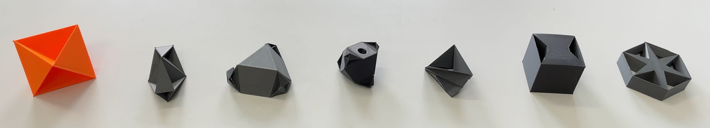

# Polyhedra of Constant Gaussian Curvature

This repository provides 3D printable models as companion materials to the paper:

**Polyhedra of Constant Gaussian Curvature**
by Soto Hisakawa, Shizuo Kaji, and Ryo Kawai, 2025

## Overview

Whilst any closed smooth surface embedded in ℝ³ with constant Gaussian curvature must be a sphere, the discrete setting exhibits far greater flexibility. This work demonstrates that any closed surface,
whether orientable or non-orientable and of arbitrary genus,
can be realised in ℝ³ as a (possibly self-intersecting) polyhedral surface in which every vertex has the same angular defect.

## Contents

### 3D Models

The `3D_data/` directory contains STL files for 3D printing of selected constant curvature polyhedra:

**Orientable surfaces:**
- `Orientable_g1_v9.stl` — Flat torus (genus 1, 9 vertices)
- `Orientable_g2_v24.stl` — Genus 2 surface (24 vertices)
- `Orientable_g3_v24.stl` — Genus 3 surface (24 vertices)
- `Orientable_g6_v36.stl` — Genus 6 surface (36 vertices)

**Non-orientable surfaces:**
- `Non_Orientable_g1_v6.stl` — Real projective plane (tetrahemihexahedron, 6 vertices)
- `Non_Orientable_g2_v9_part.stl` — Klein bottle (genus 2, 9 vertices)
- `Non_Orientable_g3_v18_part_*.stl` — Genus 3 surface (18 vertices, 2 parts)
- `Non_Orientable_g4_v24_part_*.stl` — Genus 4 surface (cubohemioctahedron, 24 vertices, 2 parts)


## Related Resources

Interactive 3D models are also available on GeoGebra: [https://www.geogebra.org/u/hisakawa](https://www.geogebra.org/u/hisakawa)

## Citation

If you use these models or constructions in your work, please cite:

```
@article{hisakawa2025polyhedra,
  title={Polyhedra of Constant Gaussian Curvature},
  author={Hisakawa, Soto and Kaji, Shizuo and Kawai, Ryo},
  year={2025}
}
```

## Licence

Please contact the authors regarding the use and distribution of these materials.

## Acknowledgements

We are grateful to Professor T. Tsuboi and Professor J. Ito for stimulating discussions. The second-named author acknowledges support from KAKENHI, Grant-in-Aid for Scientific Research (B) 25K00921 and (S) 25H00399.
