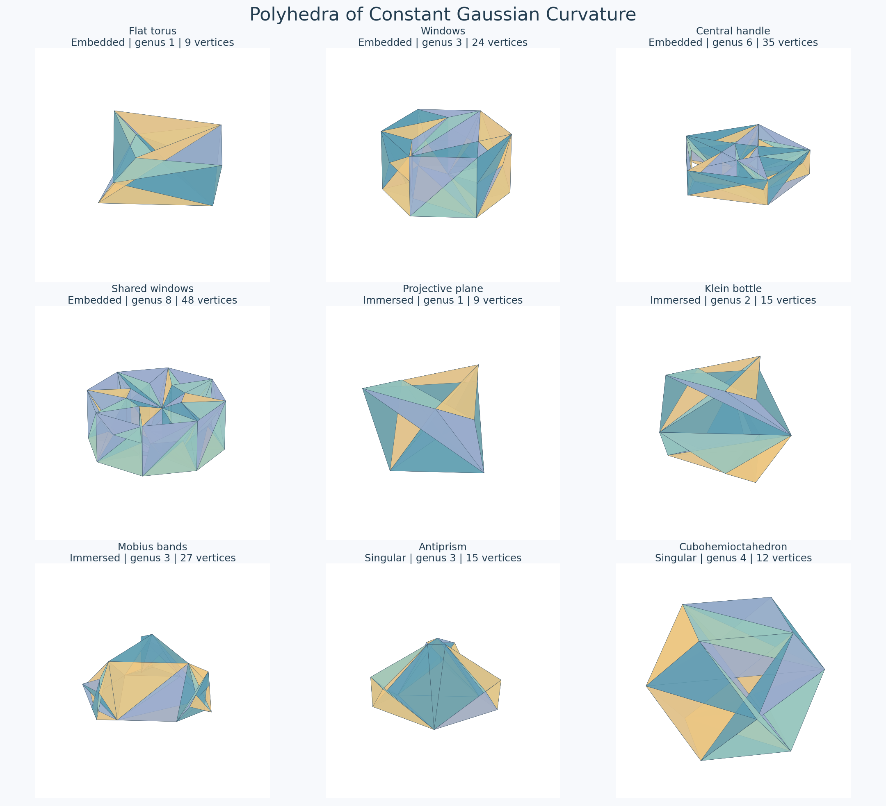

# Polyhedra of Constant Gaussian Curvature

3D models accompanying [Polyhedra of Constant Gaussian Curvature](https://arxiv.org/abs/2512.19106), by Soto Hisakawa, Shizuo Kaji, and Ryo Kawai.

Whilst any closed smooth surface embedded in $\R^3$ with constant Gaussian curvature must be a sphere, the discrete setting exhibits far greater flexibility. This work demonstrates that any closed surface,
whether orientable or non-orientable and of arbitrary genus,
can be realised in $\R^3$ as a (possibly self-intersecting) polyhedral surface in which every vertex has the same angular defect, which is a discrete analogue of Gaussian curvature for which the Gauss--Bonnet theorem holds. Specifically, we prove that every connected closed surface admits a polyhedral immersion with equal angular defects, and every orientable surface admits an embedding.





## Files and names

| Directory | Contents |
|---|---|
| [`stl/`](stl/) | Triangulated mathematical surfaces, in the paper's coordinate units |
| [`3dprint/`](3dprint/) | Closed solid STL files in millimetres, with individual generation/validation reports |
| [`models/`](models/README.md) | Full catalog, original coordinates/incidences/parameters in JSON, and validation results |
| [`scripts/`](scripts/) | Python construction, triangulation, printing, preview, and verification scripts |
| [`geogebra/`](geogebra/) | Existing GeoGebra files, retained without regeneration |

Names have the form

```text
{embedded|immersed|singular}_{orientable|nonorientable}_g{genus}_v{vertices}_{construction}.stl
```

These terms follow the revised paper: **embedded** surfaces have no self-intersections; **immersed** surfaces may have intersecting sheets but are locally injective; **singular** models also allow singular vertex stars. `g` is orientable genus or non-orientable crosscap genus, respectively. `v` counts the original polygon vertices, before export subdivisions or thickening. Names containing `historical` identify earlier constructions.

## Included constructions

| Family | Included genera | Paper vertex count |
|---|---|---|
| Regular tetrahedron; embedded flat torus | 0; 1 | 4; 9 |
| Prism with windows | 2–8 | 8g |
| Adjacent windows sharing vertices | 5–8 | 6g |
| Central handle | 4, 5, 6 | 7g−7 |
| Octagonal drilling of the genus-two window surface | 3 | 32 |
| Immersed projective plane; flat Klein bottle | 1; 2 | 9; 15 |
| Immersed Möbius bands on a convex core | 3–6 | 9g |
| Singular tetrahemihexahedron; Klein bottle; flat torus | 1; 2; orientable 1 | 6; 9; 6 |
| Singular antiprism construction | 3, 5, 7, 9, 11 | 5g |
| Singular uniform core construction | 3, 4, 13 | 6g |
| Cubohemioctahedron; hexagonal drilling | 4; 6 | 12; 24 |
| Small rhombihexahedron; square drilling | 8; 10 | 24; 32 |
| Small dodecahemidodecahedron | 14 | 30 |
| Historical cube; historical cuboctahedron with four bands | orientable 2; non-orientable 4 | 24; 24 |

See the [full catalog](models/README.md) for individual STL links and source references. Family functions accept further genera where the paper's construction permits them; the catalog is a finite selection.

## Mathematical surfaces and printing

Every generated source model is a **closed abstract surface**: each polygon edge belongs to exactly two faces, and each vertex link is one cycle. Shared corners use identical coordinates. Concave polygons are triangulated along internal diagonals, preserving the paper's faces and angle defects.

For four singular examples, triangulation creates distinct abstract diagonals with the same endpoints. Their STL export subdivides face interiors using distinct flat vertices so that the reloaded STL also has exactly two triangles per edge. These additional vertices have zero defect; the constant-defect assertion refers to the original vertices. JSON preserves the original polygon presentation.

An intersecting or non-orientable mathematical surface is not the boundary of an ordinary solid. For printing, use **`3dprint/`**. Embedded models are scaled to a maximum extent of 80 mm. Immersed and singular models are thickened to approximately 2.4 mm using a sampled distance field with 0.8 mm grid spacing; intersecting sheets are fused. These print aids have different vertex counts, defects, and potentially topology from their source surfaces. Their output extent is approximately 82.4 mm. Subvoxel cavity removal and sampling parameters are recorded in the adjacent JSON reports.

## Reproduction

```sh
python -m pip install -r scripts/requirements.txt
python scripts/generate_models.py --printable --preview
python scripts/generate_models.py --check --printable
python scripts/test_models.py
python scripts/check_embedded_intersections.py --output models/embedded_intersections.json
```

The generation command writes mathematical models, print solids, JSON/OBJ data, the catalog, validation results, and preview. Without `--printable`, only mathematical data are regenerated. A filtered run leaves the full catalog unchanged:

```sh
python scripts/generate_models.py --list
python scripts/generate_models.py --model '*g4*'
python scripts/generate_models.py --model 'immersed_nonorientable_g1_v9_projective_plane' --printable --size-mm 100 --thickness-mm 2.4 --pitch-mm 0.4 --output build
```

`--output` selects a separate output directory. The compatibility command `python scripts/flat-torus.py` regenerates the corrected nine-vertex embedded torus in the canonical location.

Checks cover genus, orientability, polygon planarity and simplicity, closed vertex/edge incidences, equal angular defects, triangulation area and angle preservation, and STL round trips. [`models/validation.json`](models/validation.json) records numerical errors. The separate pairwise triangle-intersection check confirms no forbidden intersections in the 18 embedded examples; it supplements the paper's analytic proofs with a floating-point check.

## Related resources

Interactive models: [Soto Hisakawa on GeoGebra](https://www.geogebra.org/u/hisakawa).

## Citation

```bibtex
@article{hisakawa2025polyhedra,
  title={Polyhedra of Constant Gaussian Curvature},
  author={Hisakawa, Soto and Kaji, Shizuo and Kawai, Ryo},
  journal={arXiv preprint arXiv:2512.19106},
  url={https://arxiv.org/abs/2512.19106},
  year={2025}
}
```

## Acknowledgements

We are grateful to Professor T. Tsuboi and Professor J. Itoh for stimulating discussions. The second-named author acknowledges support from KAKENHI, Grant-in-Aid for Scientific Research (B) 25K00921 and (S) 25H00399.
